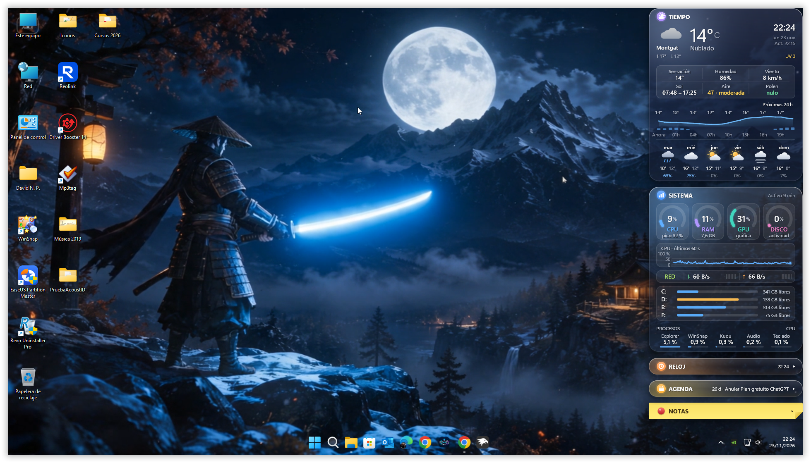
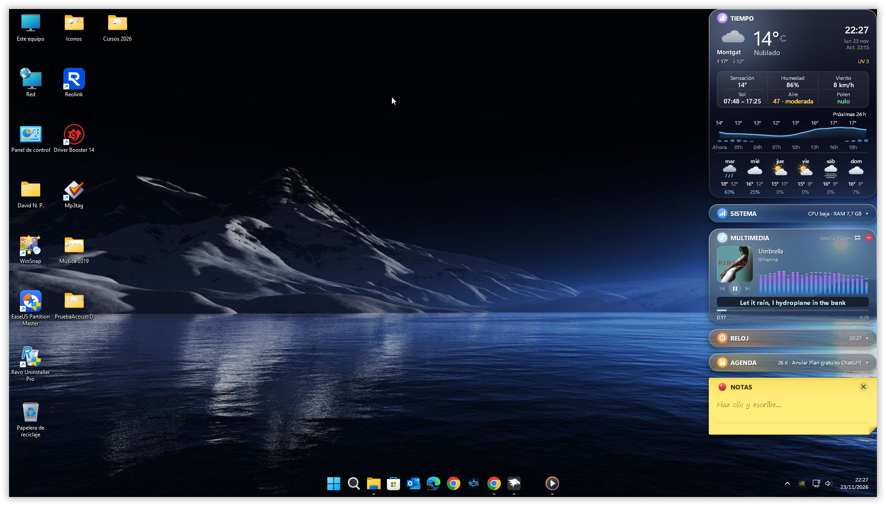
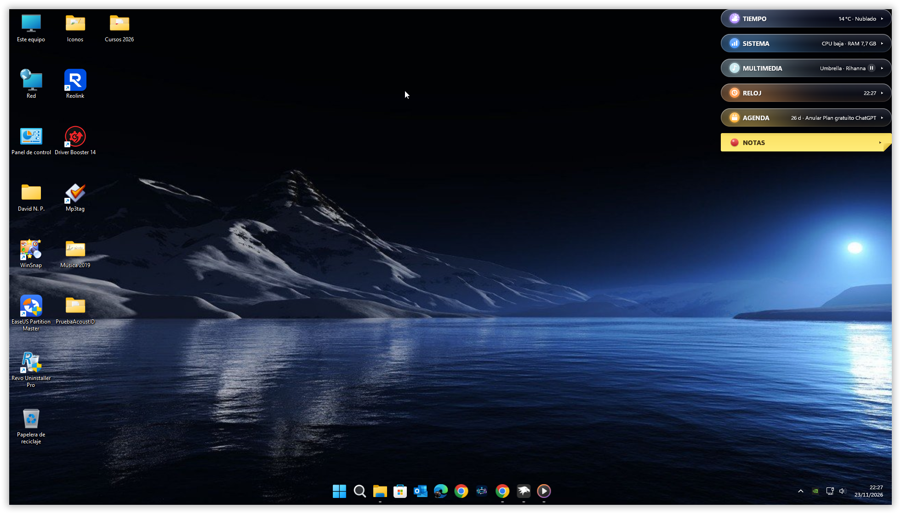

# Desktop Glass Cards

**Six translucent glass cards for your Windows desktop.** Weather, clock and Pomodoro, system monitor, calendar, notes and a media player — frosted glass, real live data, no browser, no Electron, no background app. One Windhawk mod, one `.wh.cpp` file.

## Why this exists

Rainmeter skins need a skin, a theme and a lot of patience. Widgets panels are fixed. Sidebar gadgets died with Windows 7. Desktop Glass Cards puts six real cards on top of your wallpaper with the look of Windows 11 acrylic — and they read the machine directly, so what they show is what the machine is doing.

- **Nothing to install beyond Windhawk.** No runtime, no installer, no service, no separate `.exe`. The mod compiles inside Windhawk and runs inside `explorer.exe`.
- **Live data, not a snapshot.** Weather with an interactive 24-hour chart, CPU and GPU load, per-process readings, disk and network throughput, Wi-Fi, battery.
- **A media card that actually knows the track.** Cover art, transport, progress, a spectrum visualizer, synchronized lyrics from LRCLIB, and an MP3 tag editor with acoustic identification.
- **Speaks your language.** English by default; Spanish and Catalan available in Settings.
- **Free and open source.** MIT-style notices for the bundled parts, source in plain C++ you can read.

Six translucent desktop cards for Windhawk on 64-bit Windows. Drag any card to move the stack. Click a heading to collapse or expand that card. Use the context menu to collapse or expand all cards, change their order, or lock their position. The default global shortcut is **Ctrl+Alt+F9**.

- **Weather** shows current conditions, an interactive 24-hour temperature and rain chart, and a six-day forecast. Optional panels include apparent temperature, humidity, wind, sunrise, sunset, air quality, and pollen. The card retains the last forecast during a failed refresh.
- **Clock** shows local time and up to three additional time zones. Choose a digital or analog display and set work and break intervals for the Pomodoro timer. A collapsed card shows local time or the running countdown.
- **System** shows CPU, RAM, optional GPU and disk activity, a 60-second CPU chart, network download and upload rates, and the busiest processes. Storage, battery, and Wi-Fi are configurable. Process memory is private committed memory. Point to the CPU chart or a process for a detailed reading.
- **Calendar** combines local events with optional local or remote iCalendar feeds. Click a countdown to mark or unmark an event and click its location to open it in Maps. The collapsed card can hide the next event's name.
- **Notes** is an automatically saved sticky note. Click the note to edit it. Press Esc or click outside to finish. The corner button clears the note and allows you to undo the last clear.
- **Media** shows cover art, track details, transport controls, progress, and a spectrum visualizer. Click the track title to copy the title and artist. Hover over a long title to scroll it. Click or drag the progress bar when the player supports seeking.

## Media controls and lyrics

The card normally follows a playing session. Use **Switch player** in its context menu or **Shift + mouse wheel** to cycle through sessions. The regular mouse wheel adjusts the selected application's volume when Windows can identify its audio session. Shuffle, repeat, and seeking depend on the player. Global media shortcuts are optional.

The visualizer attempts to capture the selected application and its child processes. It uses the default Windows output when that capture is unavailable. Capture pauses when playback pauses or the card is collapsed or hidden. Enable **Keep the card visible while stopped** if your player keeps a stopped session open.

Synchronized lyrics from LRCLIB have a separate, accent-colored row. The card expands for lyrics while keeping the album and year visible. The lookup uses title, artist, duration, and album when available, and skips browser sessions.

## Audio metadata

Open the metadata panel using the button in the Media card header.

- **A** shows supported local tags first, then catalog matches and available details from the card.
- **B** prefers an acoustic match for local MP3 files and falls back to a title and artist search through online catalogs. The panel identifies the source when available.
- When the player reports a file path, the mod can read embedded title, artist, album, year, and cover art from **MP3, FLAC, M4A, and M4B** files with supported tags. FLAC, M4A, and M4B are read-only. Other recognized formats can still show information supplied by the player or catalog.
- The card keeps the album supplied by the file or player. If that album is known, a catalog year is accepted only for a matching album.

Only **MP3** supports writing. If the player does not provide a verifiable path, confirm the suggested MP3 or select it yourself. Choose the tags and artwork, then select **Embed** to authorize the write. The editor closes once the operation is queued.

The persistent queue waits for the media sessions to stop or close and for the MP3 to become available. A changed file or interrupted write requires review. Pending changes can be inspected or canceled from any card's context menu. **Undo last change** restores the previous header when a valid backup exists. Up to five undo levels are kept per file. MP3 notices can remain visible separately when the Media card hides.

## Online services and local data

Weather needs network access. Remote calendars are requested only when configured. Catalog lookups use track title and artist. LRCLIB also receives duration and, when available, album. Acoustic matching is optional and requires your own AcoustID API key. It sends a fingerprint and the track duration. Leave the key empty to disable fingerprinting.

Napster is an optional source for missing artwork. If you have an application key for the legacy Napster music catalog (v2.2), enter it in **[Media] Napster catalog API key** and enable **Look up missing cover art online**. The mod sends title and artist to the catalog over HTTPS when a lookup reaches that source. Enter your key in Windhawk Settings and keep it out of the published source.

The mod stores caches, backups, and queued MP3 operations under LocalAppData. Catalog proposals can be reused for 30 days. The bundled fingerprinting code does not require an external executable.

## Calendar editor and card order

Right-click Calendar and choose **Edit calendar…**. Enter one local event per line. Blank lines and lines beginning with # are ignored. Use **Save** or **Ctrl+Enter** to apply, and **Cancel** or **Esc** to discard edits. Edit imported events in their original calendar.

    DD/MM/YYYY [HH:MM] Text [@daily|@weekly|@monthly|@yearly] [# Location]
    16/03/2027 07:00 Renew passport @yearly # City hall

Clock entries use **Label | Windows time zone | Country code**. The country code is optional. Run **tzutil /l** to list Windows time zone names.

Right-click any card and choose **Card order…** to set the order from top to bottom. Select a card and use **Move up** or **Move down**. **Default order** restores the original arrangement in the editor. Save to apply and persist the order. Hidden cards retain their place.

English is the default card language. Spanish and Catalan remain available in Settings.

## Requirements

| | |
|---|---|
| **OS** | Windows 10 or Windows 11, 64-bit |
| **Architecture** | x86-64 (the mod targets `explorer.exe`) |
| **Host** | [Windhawk](https://windhawk.net) installed and running |
| **Network** | Needed for weather, remote calendars, catalog lookups and lyrics; everything else works offline |
| **Optional** | An AcoustID API key for acoustic matching; a Napster catalog key for extra cover-art sources |

## Install from source

1. Open Windhawk and select **Create a New Mod**.
2. Replace the editor contents with the entire `desktop-glass-cards.wh.cpp` file.
3. Select **Compile Mod** and enable Desktop Glass Cards.
4. Open **Settings** to choose your city, time zones, and optional music folders. Back up any local edits if you are replacing a different copy of the mod.

The mod is a single `.wh.cpp` with no external binaries: the fingerprinting code is compiled in, and local audio is decoded through Media Foundation, which ships with Windows.

## Screenshots

| | |
|---|---|
|  |  |
| **Weather** with the interactive 24-hour chart, and **System** | **System** expanded: 60-second CPU chart, drives, network, busiest processes |
|  |  |
| **Clock** with three time zones and the Pomodoro timer, **Calendar** and **Notes** | **Media** with cover art, transport controls and the spectrum visualizer |
|  |  |
| **Lyrics** from LRCLIB on their own accent-coloured row | **Media** with a stopped session kept visible |

## Troubleshooting

- **A card does not appear.** Enable the mod in Windhawk and reload `explorer.exe`, or sign out and back in.
- **Weather stays empty.** The card needs network access; check that `explorer.exe` is not blocked by a firewall rule.
- **The visualizer is flat.** Some players do not expose an audio session. The mod falls back to the default Windows output; capture pauses while playback is paused or the card is collapsed.
- **No cover art.** The player may not provide a path and the catalog may have no confident match; the card then shows a music note. For local files, use panel **B** to identify the MP3.
- **Nothing is written to the MP3.** Writes are queued until the player releases the file. Inspect or cancel the queue from any card's context menu.
- **The card language is wrong.** English is the default; Spanish and Catalan are chosen in Windhawk Settings.

## Contributing

Issues and pull requests are welcome. The whole mod is one file, `desktop-glass-cards.wh.cpp`; keep the `@version` header in step with the change and make sure it compiles inside Windhawk before opening a pull request. Bug reports are much easier to act on with the Windhawk log (`Wh_Log` output) and your Windows build number.

## Support the project

Desktop Glass Cards is free and stays free. If it earns a place on your desktop, you can buy the author a coffee at **[ko-fi.com/davidnadalperez](https://ko-fi.com/davidnadalperez)**.

## License and third-party notices

The mod code is published by David Nadal Pérez. The bundled portions of Chromaprint and Kiss FFT keep their original MIT licence and are listed in [THIRD-PARTY-NOTICES.md](THIRD-PARTY-NOTICES.md).

## Repository layout

    desktop-glass-cards.wh.cpp   the mod (single file, compiled inside Windhawk)
    README.md                    this document
    THIRD-PARTY-NOTICES.md       Chromaprint and Kiss FFT licences
    screenshots/                 the captures used above

The notices apply to the bundled code. The repository owner can add a separate license for the original mod code.
