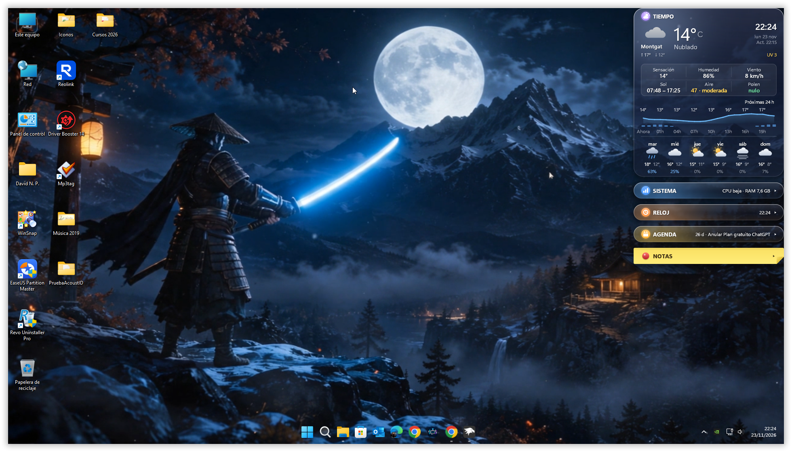
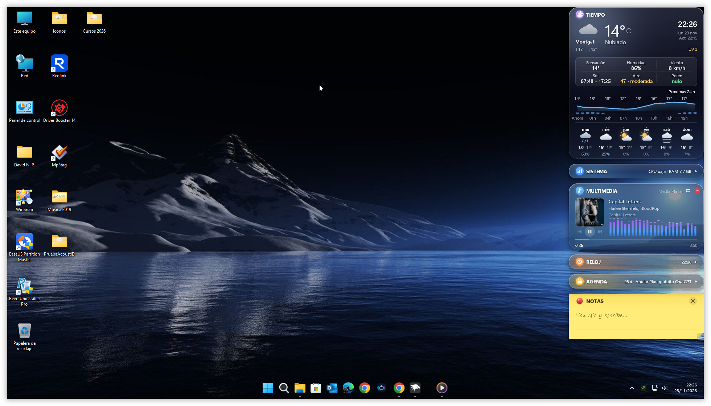
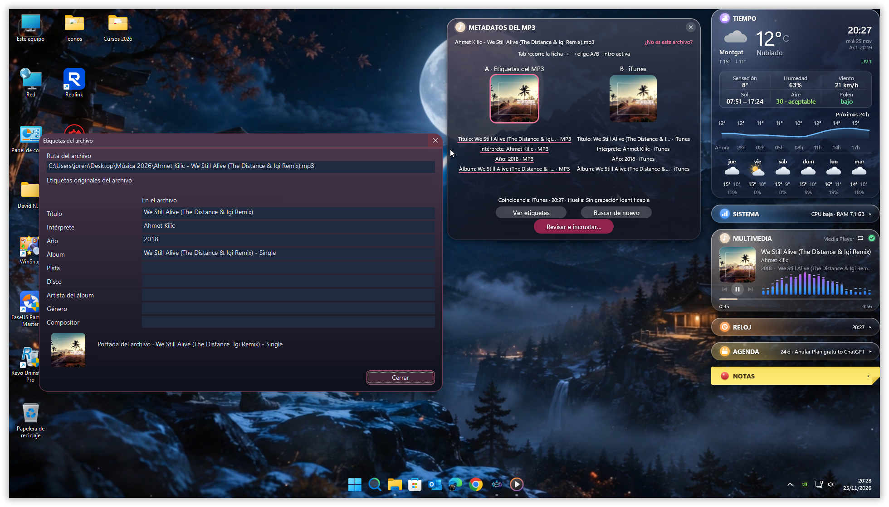

# Desktop Glass Cards

**Six translucent glass cards for your Windows desktop / Seis tarjetas translúcidas de cristal para el escritorio de Windows.** Weather, clock and Pomodoro, system monitor, calendar, notes and a media player — frosted glass, real live data, no browser, no Electron, no background app. One Windhawk mod, one `.wh.cpp` file.

*El mod de cristal translúcido para Windhawk: tiempo, reloj y Pomodoro, monitor de sistema, agenda, notas y reproductor multimedia con carátulas, ecualizador, letras sincronizadas y editor de etiquetas MP3.*

**Language / Idioma:** [🇬🇧 English](#-english) · [🇪🇸 Español](#-español)

---

# 🇬🇧 English

Six translucent desktop cards for Windhawk on 64-bit Windows. Drag any card to move the stack. Click a heading to collapse or expand that card. Use the context menu to collapse or expand all cards, change their order, or lock their position. The default global shortcut is **Ctrl+Alt+F9**.

- **Weather** shows current conditions, an interactive 24-hour temperature and rain chart, and a six-day forecast. Optional panels include apparent temperature, humidity, wind, sunrise, sunset, air quality, and pollen. The card retains the last forecast during a failed refresh.
- **Clock** shows local time and up to three additional time zones. Choose a digital or analog display and set work and break intervals for the Pomodoro timer. A collapsed card shows local time or the running countdown.
- **System** shows CPU, RAM, optional GPU and disk activity, a 60-second CPU chart, network download and upload rates, and the busiest processes. Storage, battery, and Wi-Fi are configurable.
- **Calendar** combines local events with optional local or remote iCalendar feeds. Click a countdown to mark or unmark an event and click its location to open it in Maps.
- **Notes** is an automatically saved sticky note. Click the note to edit it. Press Esc or click outside to finish. The corner button clears the note and allows you to undo the last clear.
- **Media** shows cover art, track details, transport controls, progress, and a spectrum visualizer. Click the track title to copy the title and artist. Hover over a long title to scroll it.

## What's new in 9.30.2

- The Media card reads local title, artist, album, year and artwork when the file is identified, even while the player thumbnail is loading. Local values take priority.
- The mod reads text and cover art from ID3v2.2. ID3v1 supplies missing title, artist, album or year, including when a newer header is unreadable.
- **File tags** lists the original values, shows the source path and previews embedded artwork. The panel marks suggested files so you can verify the path.
- The tag viewer, review, calendar, card-order, path and confirmation windows share the mod's palette, gradient surfaces and rounded buttons. Window corners depend on Windows support. Notes keeps its paper look with smoother corners.
- The Windhawk header and HTTP user agent now report the same version.

## Media controls and lyrics

The card normally follows a playing session. Use **Switch player** in its context menu or **Shift + mouse wheel** to cycle through sessions. The regular mouse wheel adjusts the selected application's volume when Windows can identify its audio session. Shuffle, repeat, and seeking depend on the player.

The visualizer attempts to capture the selected application and its child processes. It uses the default Windows output when that capture is unavailable. Capture pauses when playback pauses or the card is collapsed or hidden.

Synchronized lyrics from LRCLIB have a separate, accent-colored row. The card expands for lyrics while keeping the album and year visible. The lookup uses title, artist, duration, and album when available, and skips browser sessions.

## Audio metadata

Open the metadata panel from the Media header.

- **A** shows local tags first and fills missing fields with available catalog or player data. If the album is known, a catalog year is used only for a matching release.
- **B** offers acoustic identification for confirmed local MP3s and falls back to a title and artist search. The panel reports issues such as missing credentials, weak matches and tied recordings. **B · Choose release** compares up to six MusicBrainz releases when available.
- The mod reads title, artist, album, year and artwork from MP3, FLAC, M4A and M4B files with supported tags. Writing is available for MP3s with compatible tags. ID3v2.2, protected tags, FLAC, M4A and M4B are read-only.

If the player omits the path, confirm a suggested MP3 or use the file picker. **View tags** or **Ctrl+I** opens **File tags**. **Search again** retries the lookup.

Use **Review and embed…** or **Ctrl+Enter** to compare original and proposed values. **Show all fields** also lets you review or edit track number, disc number, album artist, genre and composer. The editor closes once the operation is queued.

The persistent queue waits for the media sessions to stop or close and for the MP3 to become available. A changed file or interrupted write requires review. **Undo last change** restores the previous header when a valid backup exists. Up to five undo levels are kept per file.

## Cover art sources

Nine sources, all optional except the first three. **[Cover art] Sources and order** in Settings picks which ones run and in what order; a source that needs a key is skipped when the key is empty.

| Source | Key needed | Where to get it |
|---|---|---|
| iTunes / Apple Music | no | — |
| Deezer | no | — |
| MusicBrainz + Cover Art Archive | no | — |
| TheAudioDB | optional | theaudiodb.com/api_forms/register.php |
| Last.fm | yes | last.fm/api/account/create |
| Discogs | optional | discogs.com/settings/developers |
| Genius | yes | genius.com/api-clients |
| Spotify | yes (ID + secret) | developer.spotify.com/dashboard |
| Amazon | no (via MusicBrainz ASIN) | — |

## Screenshots

| | |
|---|---|
|  |  |
| **Weather** with the interactive 24-hour chart, and **System** | **System** expanded: 60-second CPU chart, drives, network, busiest processes |
|  |  |
| **Clock** with three time zones and the Pomodoro timer, **Calendar** and **Notes** | **Media** with cover art, transport controls and the spectrum visualizer |
|  |  |
| **Lyrics** from LRCLIB on their own accent-coloured row | **Media** with a stopped session kept visible |
|  | |
| **Metadata panel** comparing the MP3's own tags (A) with an iTunes match (B), side by side, with the **File tags** viewer open on the left | |

## Requirements & install

| | |
|---|---|
| **OS** | Windows 10 or Windows 11, 64-bit |
| **Host** | [Windhawk](https://windhawk.net) installed and running |
| **Network** | Weather, remote calendars, catalogs and lyrics; the rest works offline |

1. Open Windhawk and select **Create a New Mod**.
2. Replace the editor contents with the entire `desktop-glass-cards.wh.cpp` file.
3. Select **Compile Mod** and enable Desktop Glass Cards.
4. Open **Settings** to choose your city, time zones, cover art sources and music folders.

## Troubleshooting

- **A card does not appear.** Enable the mod in Windhawk and reload `explorer.exe`, or sign out and back in.
- **Weather stays empty.** The card needs network access; check that `explorer.exe` is not blocked by a firewall rule.
- **The visualizer is flat.** Some players expose no audio session; the mod falls back to the default output.
- **No cover art.** The catalog may have no confident match. Add a key for the source you want, or check the order in **Sources and order**.
- **Nothing is written to the MP3.** Writes are queued until the player releases the file. Inspect the queue from any card's context menu.

See [THIRD-PARTY-NOTICES.md](THIRD-PARTY-NOTICES.md) for the bundled Chromaprint and Kiss FFT notices.

---

# 🇪🇸 Español

Seis tarjetas de escritorio translúcidas para Windhawk en Windows de 64 bits. Arrastra cualquier tarjeta para mover todo el bloque. Haz clic en una cabecera para plegar o desplegar esa tarjeta. Usa el menú contextual (botón derecho) para plegar o desplegar todas, cambiar su orden o bloquear su posición. El atajo global por defecto es **Ctrl+Alt+F9**.

- **Tiempo**: condiciones actuales, gráfica interactiva de temperatura y lluvia de 24 horas y previsión de seis días. Paneles opcionales: sensación térmica, humedad, viento, salida y puesta del sol, calidad del aire y polen. Si falla una actualización, la tarjeta conserva la última previsión.
- **Reloj**: hora local y hasta tres zonas horarias más. Digital o analógico, con intervalos de trabajo y descanso para el Pomodoro. Plegada muestra la hora o la cuenta atrás.
- **Sistema**: CPU, RAM, GPU y discos opcionales, gráfica de CPU de 60 segundos, velocidad de bajada y subida de red y los procesos que más consumen. Almacenamiento, batería y Wi-Fi configurables.
- **Agenda**: eventos locales más fuentes iCalendar locales o remotas opcionales. Un clic en la cuenta atrás marca o desmarca el evento; un clic en el lugar lo abre en Mapas.
- **Notas**: nota adhesiva con guardado automático. Pulsa Esc o haz clic fuera para terminar. El botón de la esquina la vacía y permite deshacer el último borrado.
- **Multimedia**: carátula, datos del tema, controles de reproducción, progreso y ecualizador de espectro. Un clic en el título copia «intérprete - título». Si el título es largo, al pasar el ratón se desplaza.

## Novedades de la 9.30.2

- La tarjeta Multimedia lee título, intérprete, álbum, año y carátula del archivo identificado, incluso mientras carga la miniatura del reproductor. Los datos locales tienen prioridad.
- Se leen texto y carátula de ID3v2.2. ID3v1 rellena título, intérprete, álbum o año que falten, incluso cuando la cabecera nueva no se puede leer.
- **Etiquetas del archivo** lista los valores originales, muestra la ruta de origen y previsualiza la carátula incrustada. El panel marca los archivos sugeridos para que compruebes la ruta.
- El visor de etiquetas, la revisión, la agenda, el orden de tarjetas, la ruta y las confirmaciones comparten la paleta del mod, superficies con degradado y botones redondeados. Las esquinas dependen de lo que soporte Windows. Notas conserva su aspecto de papel con esquinas más suaves.
- La cabecera de Windhawk y el agente de usuario HTTP informan de la misma versión.

## Controles multimedia y letras

La tarjeta sigue normalmente la sesión que suena. Con **Cambiar reproductor** en el menú contextual, o **Mayús + rueda del ratón**, se recorren las sesiones. La rueda normal ajusta el volumen de la aplicación seleccionada cuando Windows sabe identificar su sesión de audio. Aleatorio, repetición y salto dependen del reproductor.

El ecualizador intenta capturar la aplicación seleccionada y sus procesos hijos. Si no puede, usa la salida predeterminada de Windows. La captura se pausa cuando se pausa la música, o cuando la tarjeta está plegada u oculta.

Las letras sincronizadas de LRCLIB ocupan su propia fila, en color de acento. La tarjeta se expande para las letras sin ocultar el álbum ni el año. La consulta usa título, intérprete, duración y álbum cuando están disponibles, y se salta las sesiones de navegador.

## Metadatos del MP3

El panel de metadatos se abre desde la cabecera de Multimedia.

- **A** muestra primero las etiquetas locales y completa los campos ausentes con datos de catálogo o del reproductor. Si el álbum es conocido, un año de catálogo se acepta solo para esa edición.
- **B** ofrece identificación acústica para MP3 locales confirmados y, si no, búsqueda por título e intérprete. El panel avisa de credenciales ausentes, coincidencias débiles o grabaciones empatadas. **B · Elegir edición** compara hasta seis ediciones de MusicBrainz.
- Se leen título, intérprete, álbum, año y carátula de archivos MP3, FLAC, M4A y M4B con etiquetas compatibles. Solo se escribe en MP3 con etiquetas compatibles. ID3v2.2, etiquetas protegidas, FLAC, M4A y M4B son de solo lectura.

Si el reproductor no da la ruta, confirma el MP3 sugerido o elígelo tú. **Ver etiquetas** o **Ctrl+I** abre **Etiquetas del archivo**. **Buscar de nuevo** repite la consulta.

**Revisar e incrustar…** o **Ctrl+Enter** compara los valores originales con la propuesta. **Mostrar todos los campos** permite revisar o editar número de pista, número de disco, artista del álbum, género y compositor. El editor se cierra al encolar la operación.

La cola espera a que la sesión multimedia termine o se cierre y a que el MP3 quede libre. Un archivo cambiado o una escritura interrumpida piden revisión. **Deshacer el último cambio** recupera la cabecera anterior si hay copia válida. Se guardan hasta cinco niveles por archivo.

## Fuentes de carátulas

Nueve fuentes, todas opcionales salvo las tres primeras. En **[Carátulas] Fuentes y orden** eliges cuáles se consultan y en qué orden; una fuente que necesita clave se salta sola si el campo está vacío.

| Fuente | ¿Clave? | Dónde se pide |
|---|---|---|
| iTunes / Apple Music | no | — |
| Deezer | no | — |
| MusicBrainz + Cover Art Archive | no | — |
| TheAudioDB | opcional | theaudiodb.com/api_forms/register.php |
| Last.fm | sí | last.fm/api/account/create |
| Discogs | opcional | discogs.com/settings/developers |
| Genius | sí | genius.com/api-clients |
| Spotify | sí (ID + secreto) | developer.spotify.com/dashboard |
| Amazon | no (por ASIN de MusicBrainz) | — |

## Requisitos e instalación

| | |
|---|---|
| **Sistema** | Windows 10 u 11, 64 bits |
| **Anfitrión** | [Windhawk](https://windhawk.net) instalado y en marcha |
| **Red** | Tiempo, agendas remotas, catálogos y letras; el resto funciona sin conexión |

1. Abre Windhawk y selecciona **Crear un mod nuevo**.
2. Sustituye el contenido del editor por el archivo `desktop-glass-cards.wh.cpp` completo.
3. Pulsa **Compilar mod** y activa Desktop Glass Cards.
4. Abre **Ajustes** para elegir ciudad, zonas horarias, fuentes de carátulas y carpetas de música.

## Si algo no funciona

- **No aparece una tarjeta.** Activa el mod en Windhawk y recarga `explorer.exe`, o cierra y abre sesión.
- **El tiempo queda vacío.** La tarjeta necesita red; comprueba que ninguna regla de cortafuegos bloquee `explorer.exe`.
- **El ecualizador está plano.** Algunos reproductores no exponen sesión de audio; el mod usa entonces la salida predeterminada.
- **No hay carátula.** Puede que el catálogo no tenga una coincidencia fiable. Añade la clave de la fuente que quieras o revisa el orden en **Fuentes y orden**.
- **No se escribe en el MP3.** Las escrituras se encolan hasta que el reproductor suelte el archivo. Revisa la cola desde el menú contextual de cualquier tarjeta.

Los avisos de Chromaprint y Kiss FFT están en [THIRD-PARTY-NOTICES.md](THIRD-PARTY-NOTICES.md).

---

## ☕ Apoyo / Support

Si el mod te resulta útil, puedes invitar al creador a un café · If it earns a place on your desktop, buy the author a coffee:
**[ko-fi.com/davidnadalperez](https://ko-fi.com/davidnadalperez)**

## 📜 Licencia / License

Publicado por David Nadal Pérez. Los componentes integrados de Chromaprint y Kiss FFT conservan su licencia MIT original ([THIRD-PARTY-NOTICES.md](THIRD-PARTY-NOTICES.md)).
