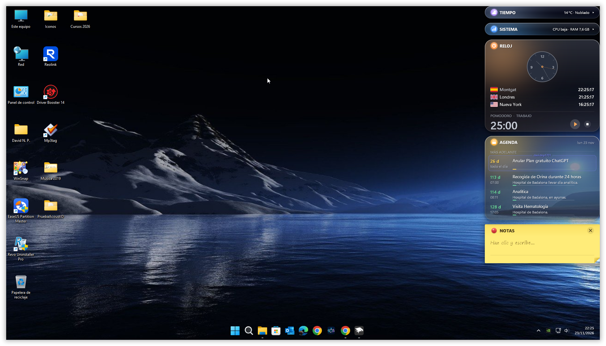

# Desktop Glass Cards

Six translucent desktop cards for Windhawk on 64-bit Windows. Drag any card to move the stack. Click a heading to collapse or expand that card. Use the context menu to collapse or expand all cards, change their order, or lock their position. The default global shortcut is **Ctrl+Alt+F9**.

- **Weather** shows current conditions, an interactive 24-hour temperature and rain chart, and a six-day forecast. Optional panels include apparent temperature, humidity, wind, sunrise, sunset, air quality, and pollen. The card retains the last forecast during a failed refresh.
- **Clock** shows local time and up to three additional time zones. Choose a digital or analog display and set work and break intervals for the Pomodoro timer. A collapsed card shows local time or the running countdown.
- **System** shows CPU, RAM, optional GPU and disk activity, a 60-second CPU chart, network download and upload rates, and the busiest processes. Storage, battery, and Wi-Fi are configurable. Process memory is private committed memory. Point to the CPU chart or a process for a detailed reading.
- **Calendar** combines local events with optional local or remote iCalendar feeds. Click a countdown to mark or unmark an event and click its location to open it in Maps. The collapsed card can hide the next event's name.
- **Notes** is an automatically saved sticky note. Click the note to edit it. Press Esc or click outside to finish. The corner button clears the note and allows you to undo the last clear.
- **Media** shows cover art, track details, transport controls, progress, and a spectrum visualizer. Click the track title to copy the title and artist. Hover over a long title to scroll it. Click or drag the progress bar when the player supports seeking.

## What's new in 9.30.2

- The Media card reads local title, artist, album, year and artwork when the file is identified, even while the player thumbnail is loading. Local values take priority.
- The mod reads text and cover art from ID3v2.2. ID3v1 supplies missing title, artist, album or year, including when a newer header is unreadable.
- **File tags** lists the original values, shows the source path and previews embedded artwork. The panel marks suggested files so you can verify the path.
- The tag viewer, review, calendar, card-order, path and confirmation windows share the mod's palette, gradient surfaces and rounded buttons. Window corners depend on Windows support. Notes keeps its paper look with smoother corners.
- The Windhawk header and HTTP user agent now report the same version.

## Media controls and lyrics

The card normally follows a playing session. Use **Switch player** in its context menu or **Shift + mouse wheel** to cycle through sessions. The regular mouse wheel adjusts the selected application's volume when Windows can identify its audio session. Shuffle, repeat, and seeking depend on the player. Global media shortcuts are optional.

The visualizer attempts to capture the selected application and its child processes. It uses the default Windows output when that capture is unavailable. Capture pauses when playback pauses or the card is collapsed or hidden. Enable **Keep the card visible while stopped** if your player keeps a stopped session open.

Synchronized lyrics from LRCLIB have a separate, accent-colored row. The card expands for lyrics while keeping the album and year visible. The lookup uses title, artist, duration, and album when available, and skips browser sessions.

## Audio metadata

Open the metadata panel from the Media header.

- **A** shows local tags first and fills missing fields with available catalog or player data. If the album is known, a catalog year is used only for a matching release.
- **B** offers acoustic identification for confirmed local MP3s and falls back to a title and artist search. The panel reports issues such as missing credentials, weak matches and tied recordings. **B · Choose release** compares up to six MusicBrainz releases when available.
- The mod reads title, artist, album, year and artwork from MP3, FLAC, M4A and M4B files with supported tags. Writing is available for MP3s with compatible tags. ID3v2.2, protected tags, FLAC, M4A and M4B are read-only.

If the player omits the path, confirm a suggested MP3 or use the file picker. Configured music folders can supply candidates ranked by tags and approximate duration. **View tags** or **Ctrl+I** opens **File tags**. **Search again** retries the lookup.

Use **Review and embed…** or **Ctrl+Enter** to compare original and proposed values. Clear a field to retain its value. **Show all fields** also lets you review or edit track number, disc number, album artist, genre and composer. Use Tab, Shift+Tab and the arrow keys to navigate. The editor closes once the operation is queued.

The persistent queue waits for the media sessions to stop or close and for the MP3 to become available. A changed file or interrupted write requires review. Pending changes can be inspected or canceled from any card's context menu. **Undo last change** restores the previous header when a valid backup exists. Up to five undo levels are kept per file. MP3 notices can remain visible separately when the Media card hides.

## Online services and local data

Weather needs network access. Remote calendars are requested only when configured. The metadata catalogs use iTunes, Deezer and MusicBrainz. **[Cover art] Sources and order** can also include TheAudioDB, Last.fm, Discogs, Spotify, Genius and Amazon for artwork. Some providers require credentials in Settings. Spotify uses the client ID and secret for the same application. Catalog lookups use track title and artist. LRCLIB also receives duration and, when available, album. Acoustic matching is optional and requires your own AcoustID API key. It sends a fingerprint and the track duration. Leave the key empty to disable fingerprinting.

The mod stores caches, backups, and queued MP3 operations under LocalAppData. Catalog proposals can be reused for 30 days. The bundled fingerprinting code does not require an external executable.

## Calendar editor and card order

Right-click Calendar and choose **Edit calendar…**. Enter one local event per line. Blank lines and lines beginning with # are ignored. Use **Save** or **Ctrl+Enter** to apply, and **Cancel** or **Esc** to discard edits. Edit imported events in their original calendar. **Overdue** shows up to three unreviewed timed events from the last seven days or today. Use the event menu to mark an entry reviewed or snooze it for 15 minutes.

    DD/MM/YYYY [HH:MM] Text [@daily|@weekly|@monthly|@yearly] [# Location]
    16/03/2027 07:00 Renew passport @yearly # City hall

Clock entries use **Label | Windows time zone | Country code**. The country code is optional. Run **tzutil /l** to list Windows time zone names.

Right-click any card and choose **Card order…** to set the order from top to bottom. Select a card and use **Move up** or **Move down**. **Default order** restores the original arrangement in the editor. Save to apply and persist the order. Hidden cards retain their place.

English is the default card language. Spanish and Catalan remain available in Settings.

## Screenshots

| | |
|---|---|
|  |  |
| **Weather** with the interactive 24-hour chart, and **System** | **System** expanded: 60-second CPU chart, drives, network, busiest processes |
|  |  |
| **Clock** with three time zones and the Pomodoro timer, **Calendar** and **Notes** | **Media** with cover art, transport controls and the spectrum visualizer |
|  |  |
| **Lyrics** from LRCLIB on their own accent-coloured row | **Media** with a stopped session kept visible |

## Install from source

1. Open Windhawk and select **Create a New Mod**.
2. Replace the editor contents with the entire desktop-glass-cards.wh.cpp file.
3. Compile the mod and enable it.
4. Choose your location, time zones and music folders in Settings.

See [THIRD-PARTY-NOTICES.md](THIRD-PARTY-NOTICES.md) for the bundled Chromaprint and Kiss FFT notices.

